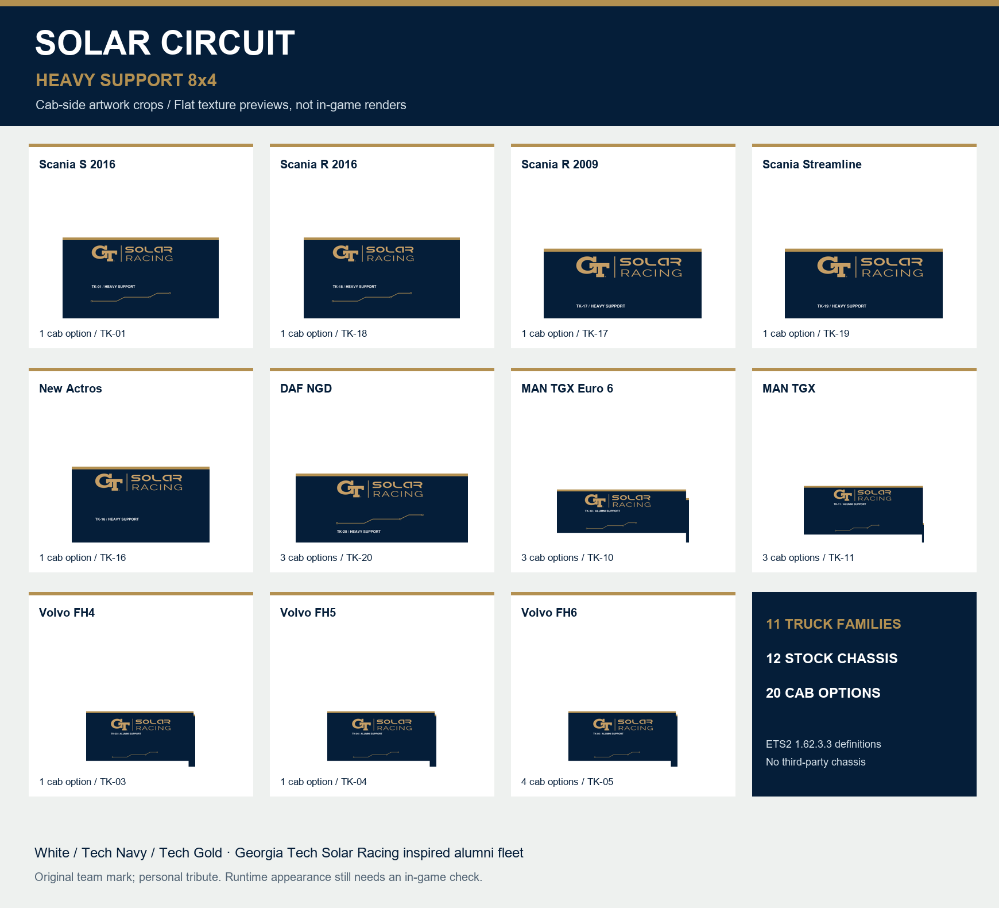
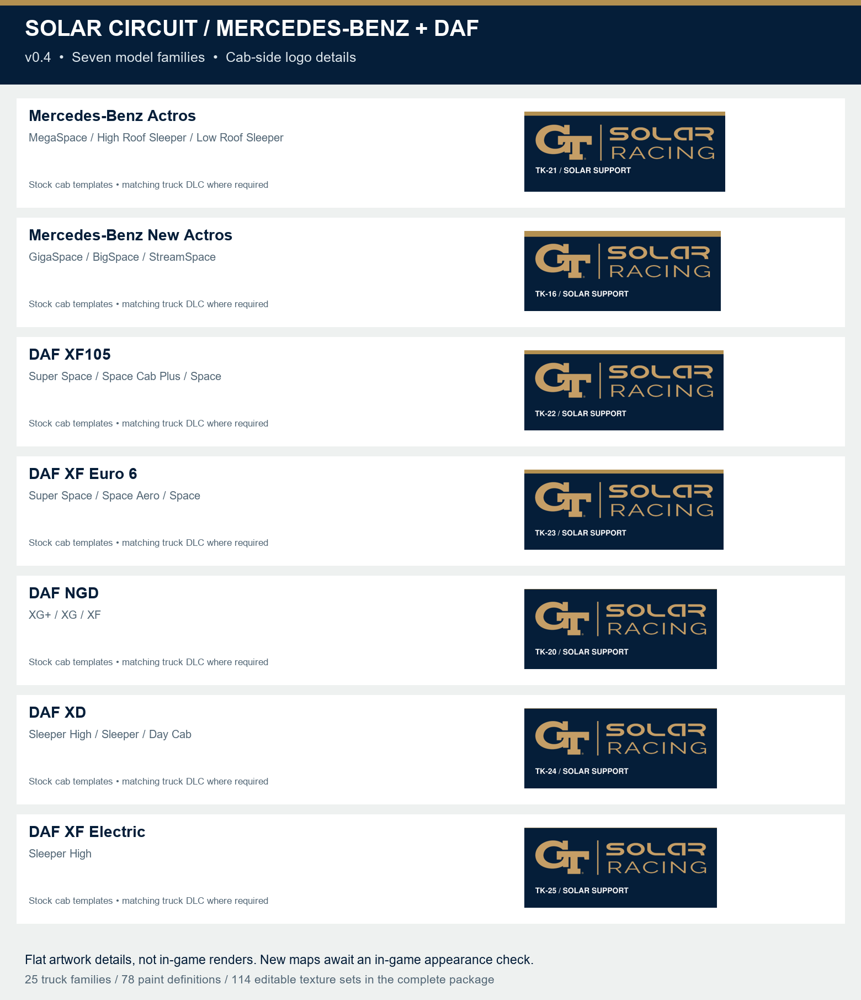
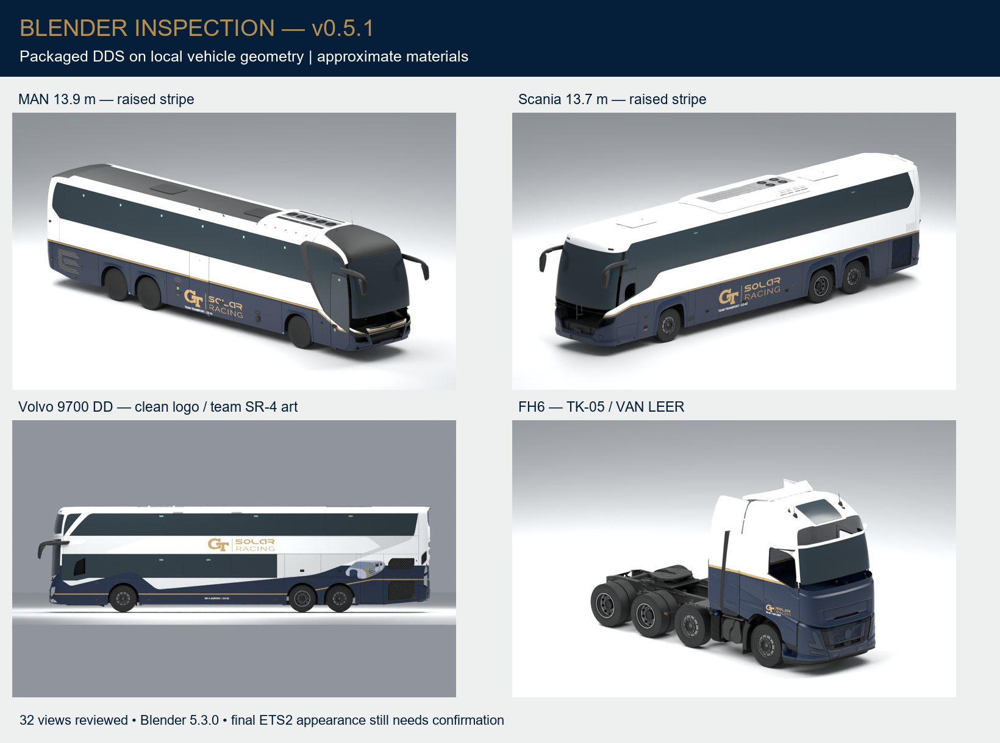

# Solar Circuit — ETS2 Fleet Theme

A Georgia Tech Solar Racing inspired personal alumni fleet theme for Euro Truck Simulator 2: white upper panels, navy lower panels, gold detailing, solar-cell geometry and a circuit trace. Includes an optional **Electrical Lead / Alumni Support** decal.






**Version 0.5.3 is an installable build for testing.** The three photographed coaches and FH6 Aero XL were checked in Blender 5.3 using the actual packaged DDS files. Final ETS2 material behavior still needs confirmation.

## FH6 stripe and logo

The Aero XL Van Leer gold stripe slopes down along the front panel line and continues across the nose. The enlarged logo and **TK-05 / VAN LEER** move down about 15 cm, retaining the reduced 936-pixel width and front-corner clearance. [Five Blender previews and truck-only upgrade](docs/FH6-LARGER-LOGO.md).

## Painted front panels

Scania 13.7 m now continues the navy/gold band across the **Standard Painted** front intake. FH6 Aero XL Van Leer uses navy painted cab arches and Exclusive Aero headlight surrounds, plus white painted sunshades. [Previews, part selections and install instructions](docs/PAINTED-FRONT-FIX.md). Ten Blender views, 1,479 checks and 25 saved-scene checks passed.

## Coach logo alignment

MAN 13.9 m and Scania 13.7 m logos now share a 1.00 m centerline and matching 0.50 m image height on both sides. Separate UV placements correct the physical height difference. [Preview, measurements and coach-only upgrade](docs/COACH-LOGO-ALIGNMENT.md). Eight Blender views, 381 alignment/export/preservation checks and 18 saved-scene checks passed.

## Native screenshot feedback and Blender

MAN and Scania stripes follow the marked luggage-panel lines. The Volvo DD logo sits directly on white, with a team-provided SR-4 illustration replacing the sketch. FH6 restores **TK-05 / VAN LEER**, paints the lower front accessories navy and the painted mirrors white. [Changes and upgrade instructions](docs/FEEDBACK-FIX.md).



The repeatable [Blender workflow](docs/BLENDER-VISUAL-CHECK.md) builds local scenes, renders eight inspection cameras per vehicle and records paint-file hashes. Original models and scenes remain private.

## Included paint-job modules

| Module | Vehicles and layouts | Limits |
| --- | --- | --- |
| [25-family truck fleet](mods/gtsr-trucks-v0.5.3.scs) | 77 paint definitions, including 19 new Mercedes/DAF options and all previous stock 8×4 options | [Mercedes/DAF coverage](docs/MERCEDES-DAF-LIVERIES.md); [8×4 coverage](docs/8X4-LIVERIES.md); matching truck DLC required |
| [SCS box trailers](mods/gtsr-trailers-v0.5.3.scs) | Owned curtainsider and dry-freighter maps in Long, Double and B-Double layouts; related bodies assigned the matching dry atlas | Related insulated, refrigerated, side-door and moving-floor variants need individual visual checks |
| [SCS coaches](mods/gtsr-coaches-v0.5.3.scs) | MAN Lion's Coach 13.9 m / 12.1 m; Scania Touring HD 13.7 m / 12.9 m; Volvo 9700 DD | Requires SCS Coaches DLC; third-party coaches are not mapped |

## Install

1. Download or clone this repository. For an individual module on GitHub, open its file and use **Download raw file**.
2. Copy the desired `.scs` files from `mods/` into your active ETS2 user-data `mod` folder. On Windows this is usually `Documents\Euro Truck Simulator 2\mod`; OneDrive redirection or a custom `-homedir` can change the location.
3. Activate the modules in ETS2 Mod Manager. All three can be enabled together. When upgrading, remove/deactivate older truck and coach modules and enable only truck v0.5.3 and coach v0.5.3.
4. On the FH6 Aero Globetrotter XL choose **Solar Circuit - Van Leer**. Other matching vehicles retain **Solar Circuit - Alumni Support** or **Solar Circuit - Heavy Support 8x4**. Switch an Aero XL off its retired Heavy selection before upgrading, or choose Van Leer afterward. Price: EUR 1,000; unlock level: 0.
5. Check both sides, front, rear, roof, seams and painted accessories before applying across your fleet. Use your usual profile backup when testing mods.

See [README.txt](README.txt) for complete instructions. Open [FLEET-GUIDE.html](FLEET-GUIDE.html) locally in a browser after downloading the repository for the visual guide. GitHub displays the HTML source rather than rendering that document.

## Package contents

- `artwork/` — editable SVG and PNG decal masters, fleet numbers, rear panel, solar strip, circuit trace and unchanged source team logo.
- `textures/` — 118 texture sets in SVG, PNG and DDS, including four aligned Van Leer accessory maps and three solid fallback colors.
- `mods/` — three installable `.scs` archives, compressed as standard ZIP files with their original contents preserved.
- `previews/` — fleet design board and example texture sheets.
- `source/` — optional rebuilding utility, dependency list, texture index and validation reports.
- `credits/` — logo provenance, template attribution and the MIT notice for adapted Paint Job Packer code patterns.

## Coverage and useful screenshots

All seven standard SCS Mercedes-Benz and DAF families are now included: Actros, New Actros, XF105, XF Euro 6, NGD XF/XG/XG+, XD and XF Electric. See the [exact cabin coverage and rebuild recipe](docs/MERCEDES-DAF-LIVERIES.md).

For refinement, capture straight left/right, front/rear, front three-quarter views from both sides, a high rear view and close-ups of problem areas. See the [prioritized screenshot checklist](docs/SCREENSHOT-CHECKLIST.md). The three photographed coach bodies are refined by v0.5.1; shorter coach bodies and other earlier-model issues remain outside this patch.

## Earlier template references

See the [Volvo, Iveco, MAN and Renault template reference](docs/TRUCK-TEMPLATES.md) for 14 SCS truck models, 37 cabin layouts, download links, exact filenames and verified dimensions. These brands are now included in the truck module; see the [livery coverage and upgrade guide](docs/TRUCK-LIVERIES.md).

## Edit and rebuild

The expanded truck module uses conditional DLC sections, supported by the rebuild utility. See [FH6-LARGER-LOGO.md](docs/FH6-LARGER-LOGO.md) for the current truck patch recipe, [PAINTED-FRONT-FIX.md](docs/PAINTED-FRONT-FIX.md) for the preceding painted-parts recipe, [COACH-LOGO-ALIGNMENT.md](docs/COACH-LOGO-ALIGNMENT.md) for the preceding logo alignment recipe, [FEEDBACK-FIX.md](docs/FEEDBACK-FIX.md) for the preceding feedback recipe, [MERCEDES-DAF-LIVERIES.md](docs/MERCEDES-DAF-LIVERIES.md) for the earlier Mercedes/DAF generator, [8X4-LIVERIES.md](docs/8X4-LIVERIES.md) for the historical 8×4 generator and [TRUCK-LIVERIES.md](docs/TRUCK-LIVERIES.md) for the earlier expansion recipe.

Edit a vehicle SVG in `textures/` at its original canvas size. Keep the team logo proportional. Text uses Arial or a compatible system font; no font files are bundled. Editing a reusable decal master does not automatically change the mapped vehicle SVGs.

With Python installed:

```sh
python -m pip install -r source/requirements.txt
python source/rebuild.py
```

Or rebuild one texture:

```sh
python source/rebuild.py --texture scania-s-high-roof
```

The utility writes updated PNG/DDS files and modules under `rebuilt/`, which Git ignores. Install either the original modules or the rebuilt modules, not duplicate copies of both. A separate vehicle model requires its own exact UV template and definitions; these maps are not universal skins.

## Validation status

Version 0.5.3: **379/379 checks** and **15 saved-scene checks** passed. Five Blender views and 342 gold-stripe samples reviewed; all opaque logo pixels remain on the painted cab. All 117 unrelated texture sets, accessory assignments and coach/trailer gameplay payloads are preserved. All three module filenames and Mod Manager versions use v0.5.3. See the [logo report](source/fh6-logo-validation.json), [scene report](source/fh6-logo-blender-validation.json) and [module version checks](source/module-version-validation.json).

Earlier 0.5.3 refinement: **1479/1479 checks** and **25 saved-scene checks** passed. Ten Blender views reviewed against three native v0.5.2 captures. All 117 unrelated texture sets, Scania side logo pixels and trailer contents were preserved. See the [painted front report](source/accessory-fix-validation.json) and [scene report](source/accessory-fix-blender-validation.json).

Historical Version 0.5.2: **381/381 checks** and **18 saved-scene checks** passed for the aligned MAN/Scania logos. Eight Blender views reviewed. All 116 unrelated texture sets and the truck/trailer archives are preserved. See the [alignment report](source/logo-alignment-validation.json) and [scene report](source/logo-alignment-blender-validation.json).

Historical Version 0.5.1: **1595/1595 refinement checks**, **1,930 geometry crossing samples**, **360/360 rebuild checks** and **40 saved-scene checks** passed. Thirty-two Blender views, 28 native v0.5.0 captures and two stripe annotations reviewed. All 114 unrelated texture sets are preserved. See the [static report](source/feedback-fix-validation.json), [rebuild report](source/feedback-fix-rebuild-validation.json) and [Blender report](source/blender-workflow-validation.json).

Historical Version 0.5.0: **1561/1561 refinement checks**, **2,490 geometry gold-crossing probes**, selected rebuilds and recipe reproduction passed. All 37 new captures and the annotated suggestion were reviewed against 25 older captures. The 110 unrelated texture sets and unrelated archive entries are preserved. See the [refinement report](source/panel-refinement-validation.json), [workflow report](source/panel-refinement-rebuild-validation.json) and [calibration record](source/panel-calibration.json). No new in-game appearance test was performed.

Historical Version 0.4.1: **1477/1477 focused checks** and **1113/1113 workflow checks** passed. Five focused overlays and 25 new feedback screenshots were reviewed. All unrelated texture exports and archive entries are preserved. See the [focused report](source/focused-fix-validation.json) and [workflow report](source/focused-fix-rebuild-validation.json). Corrected runtime appearance still needs confirmation.

Version 0.4: **1596/1596 static checks passed**, covering 114 texture sets, 78 paint definitions, all seven Mercedes/DAF cab inventories and 93 stock/tuning accessory identifiers. All 30 template overlays were reviewed. Selected base, DLC and heavy-alias editing paths and complete recipe regeneration passed **756/756 rebuild checks**. See the [validation report](source/mercedes-daf-validation.json) and [rebuild report](source/mercedes-daf-rebuild-validation.json). The new maps have not been tested in game.

Historical: the [version 0.3 report](source/8x4-validation.json) records **1164/1164 checks passed**. All 12 stock SCS 8×4 chassis definitions and 20 legal cabin/chassis pairs were checked against installed 1.62.3.3 files. All 10 new template overlays were reviewed. Earlier gameplay entries are preserved byte-for-byte. The new editing paths and recipe regeneration were also verified ([report](source/8x4-rebuild-validation.json)). No in-game appearance test was performed.

The [version 0.2 expansion report](source/expansion-validation.json) records **777/777 static checks passed** for the new truck maps and definitions. All 37 new cabin layouts and 19 auxiliary maps were reviewed against templates. Installed 1.62.3.3 truck DLC definitions were also checked, correcting one FH6 8x4 cabin-ID typo. The editing utility was also verified against base, conditional-DLC and legacy archive entries ([report](source/rebuild-validation.json)). In-game appearance remains untested.

The [original validation report](source/validation.json) records **258/258 static checks passed**: archive integrity, texture paths, image decoding, DDS DXT5/BC3 format and mip chains, dimensions, unit identifiers, UI images and coach dependency. Truck and SCS box assignments were compared with available local ETS2 **1.62.3.3** definitions. Some tuning-DLC assignments and coach definitions follow Paint Job Packer metadata and were not independently verified against extracted DLC files.

[Historical version 0.1 repository preparation checks](source/repository-validation.json) verify that compressing the `.scs` archives preserved every member's size and CRC. The user screenshots verify earlier modules loading and expose visual issues. Complete runtime coverage, side reading direction, gloss, seams, model variants, multiplayer and compatibility with other vehicle mods remain unverified.

## Identity and sources

- [SR-4 Aurora](https://solarracing.gatech.edu/cars/): reference for the original editable solar-car silhouette.
- [Georgia Tech Solar Racing](https://gtsolar.org/): team logo, palette and “Design. Build. Race.” wording.
- [Georgia Tech color guide](https://brand.gatech.edu/our-look/colors): Gold `#B39051`, Navy `#051E39`, White `#FFFFFF`.
- [Paint Job Packer v2.1.3](https://github.com/Carsmaniac/paintjob-packer/releases/tag/v2.1.3): vehicle templates and definition patterns.
- [Complete template pack with DAF XF](https://truckymods.io/euro-truck-simulator-2/tools/ets2-truck-and-trailer-templates-947834): Carsmaniac, game-version 1.59 PNG/PSD templates.
- [Template author's public guidance](https://forum.scssoft.com/viewtopic.php?f=33&t=272386).
- [SCS paint-job documentation](https://modding.scssoft.com/wiki/Documentation/Engine/Units/accessory_paint_job_data) and [mod packaging documentation](https://modding.scssoft.com/wiki/Documentation/Engine/Mod_manager).

The supplied Discord invite resolved to ProMods Community. Public invite metadata was available, but channel discussions were not read.

## Credits and rights

This is a **personal alumni tribute**, not an official Georgia Tech or Georgia Tech Solar Racing release. The fleet design name “Solar Circuit” was created for this package. Team and Georgia Tech marks remain their respective owners' property. No sponsor logos, original wireframe templates, vehicle models or game files are included.

See [full attribution](credits/ATTRIBUTION.txt) and the [Paint Job Packer MIT notice](credits/Paint-Job-Packer-MIT.txt). That MIT notice applies to the adapted code patterns identified in the attribution; it does not grant rights to team marks or license the entire artwork package.
