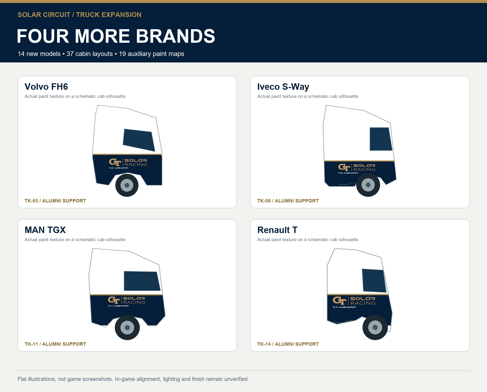

# Solar Circuit — ETS2 Fleet Theme

A Georgia Tech Solar Racing inspired personal alumni fleet theme for Euro Truck Simulator 2: white upper panels, navy lower panels, gold detailing, solar-cell geometry and a circuit trace. Includes an optional **Electrical Lead / Alumni Support** decal.





**Version 0.3 is an installable build for testing.** Static checks passed, but the paint jobs have not been tested in an ETS2 game session. Preview drawings are flat design elevations, not game screenshots.

## Included paint-job modules

| Module | Vehicles and layouts | Limits |
| --- | --- | --- |
| [20-model truck fleet](mods/gtsr-trucks-v0.3.scs) | Previous 39 paint definitions plus 20 Heavy Support options covering all stock SCS 8×4 chassis | [8×4 coverage and upgrade guide](docs/8X4-LIVERIES.md); [earlier truck coverage](docs/TRUCK-LIVERIES.md); matching truck DLC required |
| [SCS box trailers](mods/gtsr-trailers-v0.1.scs) | Owned curtainsider and dry-freighter maps in Long, Double and B-Double layouts; related bodies assigned the matching dry atlas | Related insulated, refrigerated, side-door and moving-floor variants need individual visual checks |
| [SCS coaches](mods/gtsr-coaches-v0.1.scs) | MAN Lion's Coach 13.9 m / 12.1 m; Scania Touring HD 13.7 m / 12.9 m; Volvo 9700 DD | Requires SCS Coaches DLC; third-party coaches are not mapped |

## Install

1. Download or clone this repository. For an individual module on GitHub, open its file and use **Download raw file**.
2. Copy the desired `.scs` files from `mods/` into your active ETS2 user-data `mod` folder. On Windows this is usually `Documents\Euro Truck Simulator 2\mod`; OneDrive redirection or a custom `-homedir` can change the location.
3. Activate the modules in ETS2 Mod Manager. All three can be enabled together. When upgrading, remove/deactivate older truck modules and enable only truck v0.3.
4. At the matching vehicle's paint shop, choose **Solar Circuit - Alumni Support**, or **Solar Circuit - Heavy Support 8x4** on a supported 8×4 configuration. Price: EUR 1,000; unlock level: 0.
5. Check both sides, front, rear, roof, seams and painted accessories before applying across your fleet. Use your usual profile backup when testing mods.

See [README.txt](README.txt) for complete instructions. Open [FLEET-GUIDE.html](FLEET-GUIDE.html) locally in a browser after downloading the repository for the visual guide. GitHub displays the HTML source rather than rendering that document.

## Package contents

- `artwork/` — editable SVG and PNG decal masters, fleet numbers, rear panel, solar strip, circuit trace and unchanged source team logo.
- `textures/` — 85 texture sets in SVG, PNG and DDS, including 10 new 8×4 maps and three solid fallback colors.
- `mods/` — three installable `.scs` archives, compressed as standard ZIP files with their original contents preserved.
- `previews/` — fleet design board and example texture sheets.
- `source/` — optional rebuilding utility, dependency list, texture index and validation reports.
- `credits/` — logo provenance, template attribution and the MIT notice for adapted Paint Job Packer code patterns.

## Templates for additional truck brands

See the [Volvo, Iveco, MAN and Renault template reference](docs/TRUCK-TEMPLATES.md) for 14 SCS truck models, 37 cabin layouts, download links, exact filenames and verified dimensions. These brands are now included in the truck module; see the [livery coverage and upgrade guide](docs/TRUCK-LIVERIES.md).

## Edit and rebuild

The expanded truck module uses conditional DLC sections, supported by the rebuild utility. See [8X4-LIVERIES.md](docs/8X4-LIVERIES.md) for the current 8×4 generator and [TRUCK-LIVERIES.md](docs/TRUCK-LIVERIES.md) for the earlier expansion recipe.

Edit a vehicle SVG in `textures/` at its original canvas size. Keep the team logo proportional. Text uses Arial or a compatible system font; no font files are bundled. Editing a reusable decal master does not automatically change the mapped vehicle SVGs.

With Python installed:

```sh
python -m pip install -r source/requirements.txt
python source/rebuild.py
```

Or rebuild one texture:

```sh
python source/rebuild.py --texture scania-s-high-roof
```

The utility writes updated PNG/DDS files and modules under `rebuilt/`, which Git ignores. Install either the original modules or the rebuilt modules, not duplicate copies of both. A separate vehicle model requires its own exact UV template and definitions; these maps are not universal skins.

## Validation status

The [version 0.3 report](source/8x4-validation.json) records **1164/1164 checks passed**. All 12 stock SCS 8×4 chassis definitions and 20 legal cabin/chassis pairs were checked against installed 1.62.3.3 files. All 10 new template overlays were reviewed. Earlier gameplay entries are preserved byte-for-byte. The new editing paths and recipe regeneration were also verified ([report](source/8x4-rebuild-validation.json)). No in-game appearance test was performed.

The [version 0.2 expansion report](source/expansion-validation.json) records **777/777 static checks passed** for the new truck maps and definitions. All 37 new cabin layouts and 19 auxiliary maps were reviewed against templates. Installed 1.62.3.3 truck DLC definitions were also checked, correcting one FH6 8x4 cabin-ID typo. The editing utility was also verified against base, conditional-DLC and legacy archive entries ([report](source/rebuild-validation.json)). In-game appearance remains untested.

The [original validation report](source/validation.json) records **258/258 static checks passed**: archive integrity, texture paths, image decoding, DDS DXT5/BC3 format and mip chains, dimensions, unit identifiers, UI images and coach dependency. Truck and SCS box assignments were compared with available local ETS2 **1.62.3.3** definitions. Some tuning-DLC assignments and coach definitions follow Paint Job Packer metadata and were not independently verified against extracted DLC files.

[Historical version 0.1 repository preparation checks](source/repository-validation.json) verify that compressing the `.scs` archives preserved every member's size and CRC. Runtime loading, side reading direction, gloss, seams, model variants, multiplayer and compatibility with other vehicle mods remain unverified.

## Identity and sources

- [Georgia Tech Solar Racing](https://gtsolar.org/): team logo, palette and “Design. Build. Race.” wording.
- [Georgia Tech color guide](https://brand.gatech.edu/our-look/colors): Gold `#B39051`, Navy `#051E39`, White `#FFFFFF`.
- [Paint Job Packer v2.1.3](https://github.com/Carsmaniac/paintjob-packer/releases/tag/v2.1.3): vehicle templates and definition patterns.
- [Complete template pack with DAF XF](https://truckymods.io/euro-truck-simulator-2/tools/ets2-truck-and-trailer-templates-947834): Carsmaniac, game-version 1.59 PNG/PSD templates.
- [Template author's public guidance](https://forum.scssoft.com/viewtopic.php?f=33&t=272386).
- [SCS paint-job documentation](https://modding.scssoft.com/wiki/Documentation/Engine/Units/accessory_paint_job_data) and [mod packaging documentation](https://modding.scssoft.com/wiki/Documentation/Engine/Mod_manager).

The supplied Discord invite resolved to ProMods Community. Public invite metadata was available, but channel discussions were not read.

## Credits and rights

This is a **personal alumni tribute**, not an official Georgia Tech or Georgia Tech Solar Racing release. The fleet design name “Solar Circuit” was created for this package. Team and Georgia Tech marks remain their respective owners' property. No sponsor logos, original wireframe templates, vehicle models or game files are included.

See [full attribution](credits/ATTRIBUTION.txt) and the [Paint Job Packer MIT notice](credits/Paint-Job-Packer-MIT.txt). That MIT notice applies to the adapted code patterns identified in the attribution; it does not grant rights to team marks or license the entire artwork package.
