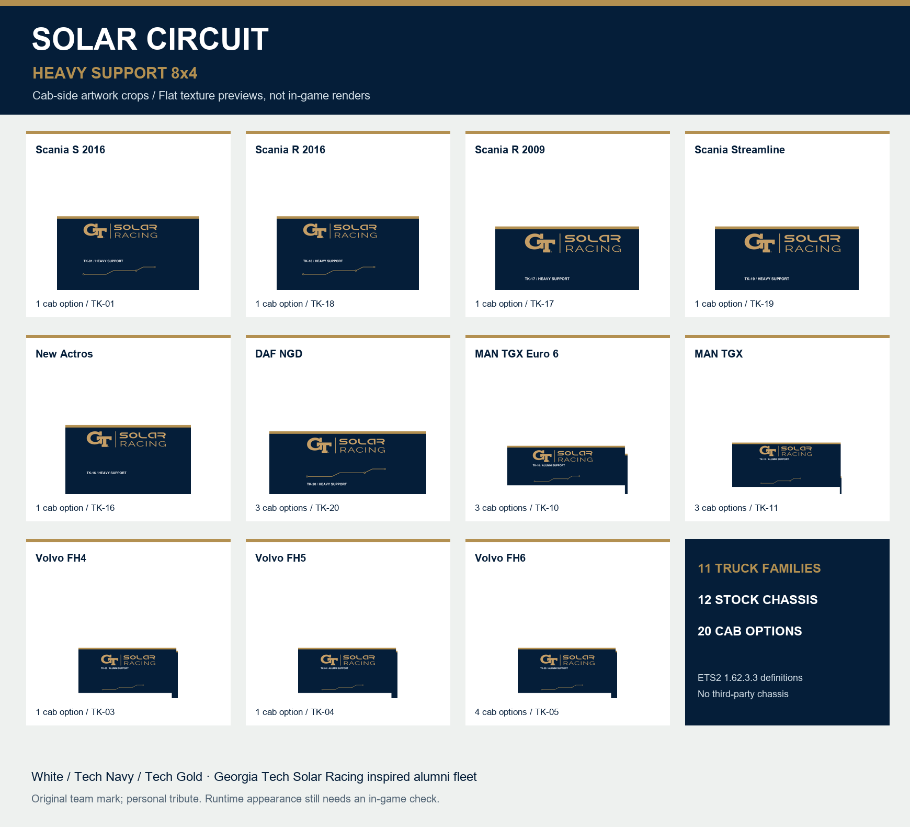

# Solar Circuit Heavy Support 8×4 — version 0.3 recipe

**Current release: version 0.4.1.** See the [focused coach/FH6 correction](FOCUSED-FIX.md). The [Mercedes/DAF expansion](MERCEDES-DAF-LIVERIES.md) retains all listed heavy restrictions and refreshes the Actros heavy map and three DAF maps. Counts, preview and generation recipe below describe the historical 0.3 stage. Use the current module for installation; download the original 0.3 seed from its GitHub release when reconstructing that stage.

The truck module covers **all standard SCS 8×4 chassis found in the installed ETS2 1.62.3.3 base and truck DLC files**: 11 truck families, 12 chassis definitions and 20 legal cabin/chassis combinations. It adds 20 separately restricted **Solar Circuit - Heavy Support 8x4** paint options. The complete fleet now has 20 truck families and 59 paint-job definitions, retaining the previous 39 definitions.



These are crops of the supplied paint maps, not game renders. Eight new cabin maps and two Scania 8×4 skirt maps were authored against the exact templates. The remaining 12 cabin configurations reuse the existing matching MAN/Volvo maps; they have individual 8×4 definitions and stock accessory assignments.

## Install and upgrade

1. Deactivate/remove older Solar Circuit truck modules, including version 0.3, from your active ETS2 mod folder.
2. Copy [gtsr-trucks-v0.4.1.scs](../mods/gtsr-trucks-v0.4.1.scs) into that folder, usually `Documents\Euro Truck Simulator 2\mod`, and enable it in Mod Manager. Use only one truck-module version.
3. Configure a supported standard SCS 8×4 chassis and its compatible cabin. Choose **Solar Circuit - Heavy Support 8x4** at the paint shop. Price: EUR 1,000; unlock level: 0. The vehicle's own cabin/chassis unlock requirements still apply.
4. Inspect both sides, equipment tower, roof, skirts and rear painted parts in daylight before applying across the fleet.

The existing **Solar Circuit - Alumni Support** options remain for earlier configurations. Trailer and coach modules stay at version 0.1. No changes were made to your active game profile.

## Exact 8×4 coverage

| Truck family | Compatible cabins | Chassis unit prefix | Configurations | Package section |
| --- | --- | --- | --- | --- |
| MAN TGX Euro 6 | XLX; XL; XXL | `8x4` | 3 | `base` |
| Mercedes-Benz New Actros | GigaSpace | `8x4` | 1 | `base` |
| Scania R 2009 | Topline | `8x4` | 1 | `base` |
| Scania R 2016 | High Roof | `8x4` | 1 | `base` |
| Scania Streamline | Topline | `8x4` | 1 | `base` |
| Scania S 2016 | High Roof | `8x4` | 1 | `base` |
| Volvo FH4 | Globetrotter XL | `8x4` | 1 | `base` |
| DAF NGD | XF; XG; XG+ | `8x4m`; `8x4m_xf` | 3 | `dlc_daf_2021` |
| MAN TGX | GM; GN; GX | `8x4` | 3 | `dlc_man_tgx_2020` |
| Volvo FH5 | Globetrotter XL | `8x4` | 1 | `dlc_volvo_fh_2021` |
| Volvo FH6 | Globetrotter XL; Aero Globetrotter XL; Globetrotter XXL; Aero Globetrotter XXL | `8x4` | 4 | `dlc_volvo_fh_2024` |

DAF uses two separate midlift chassis definitions: XG/XG+ use `8x4m`, while XF uses `8x4m_xf`. All four Volvo FH6 8×4 cabins, including both Aero variants, are covered. The upstream FH6 XXL typo is corrected to `l3h3_8x4`; Aero runtime units end in `_a`.

Iveco, Renault and other SCS models with no stock 8×4 chassis receive no invented chassis. The five added truck families (Actros, Scania R 2009, Scania R 2016, Streamline and DAF NGD) are mapped here for their listed 8×4 configurations only. Their other chassis/cabs are outside this addition.

## Artwork and accessories

White upper panels, navy lower panels, gold team marks, solar-cell motifs and circuit traces carry the original fleet identity into heavy support. Scania equipment-tower side panels receive additional solar detailing; Actros and the older Scanias have their own atlas placements. DAF XF, XG and XG+ each have a separate map. Fleet IDs continue TK-01 through TK-20.

Available Scania 8×4 skirt and Volvo 8×4 deflector templates are assigned separately. Stock paintable accessories without a dedicated atlas receive solid navy or white as recorded in [8x4-support.json](../source/8x4-support.json). Factory plastic, chrome, tanks and other non-paintable materials keep their factory appearance. No vehicle models are replaced. Existing non-8×4 archive entries remain byte-identical to version 0.2.

Truck DLC sections mount only with their matching SCS truck DLC. The new DAF section is `dlc_daf_2021`; existing sections for modern MAN, Volvo, Iveco and Renault are retained. See [SCS conditional-package guidance](https://modding.scssoft.com/wiki/Documentation/Engine/Mod_manager) and [accessory compatibility fields](https://modding.scssoft.com/wiki/Documentation/Engine/Units/accessory_data).

## Templates and editable maps

Carsmaniac's [Paint Job Packer v2.1.3 DDS pack](https://github.com/Carsmaniac/paintjob-packer/releases/download/v2.1.3/templates.zip) supplies the special 8×4 Scania/Actros atlases. The author's [complete 1.59 PNG/PSD pack](https://truckymods.io/euro-truck-simulator-2/tools/ets2-truck-and-trailer-templates-947834) supplies DAF, including XF missing from the older DDS pack. Archive and member SHA-256 values are recorded in [8x4-support.json](../source/8x4-support.json). Templates are development references; originals and wireframes are not redistributed.

| Exported texture stem | Exact source member | Canvas |
| --- | --- | --- |
| `h8_mercedes_actros2014_cab` | `ets/scs/mercedes.actros2014/Cabin 8x4 (GigaSpace).dds` | 4096 × 4096 |
| `h8_scania_r_cab` | `ets/scs/scania.r/Cabin 8x4 (Topline).dds` | 4096 × 4096 |
| `h8_scania_r_2016_cab` | `ets/scs/scania.r_2016/Cabin 8x4 (High Roof).dds` | 4096 × 4096 |
| `h8_scania_r_2016_skirts` | `ets/scs/scania.r_2016/Sideskirts (8x).dds` | 1024 × 2048 |
| `h8_scania_streamline_cab` | `ets/scs/scania.streamline/Cabin 8x4 (Topline).dds` | 4096 × 4096 |
| `h8_scania_s_2016_cab` | `ets/scs/scania.s_2016/Cabin 8x4 (High Roof).dds` | 4096 × 4096 |
| `h8_scania_s_2016_skirts` | `ets/scs/scania.s_2016/Sideskirts (8x).dds` | 1024 × 2048 |
| `h8_daf_2021_xf` | `DAF NGD/Cabin C (XF).png` | 4096 × 4096 |
| `h8_daf_2021_xg` | `DAF NGD/Cabin B (XG).png` | 4096 × 4096 |
| `h8_daf_2021_xg_plus` | `DAF NGD/Cabin A (XG+).png` | 4096 × 4096 |

The package contains 85 editable texture sets in total. New maps use `h8_*.svg`; the PNG and BC3/DXT5 DDS files are exported alongside them. All have full mip chains and opaque body alpha. To rebuild an edited map:

```sh
python -m pip install -r source/requirements.txt
python source/rebuild.py --texture h8_scania_s_2016_cab
```

To regenerate this addition from the two downloaded original archives:

```sh
python source/build_8x4.py --templates /path/to/templates.zip --complete-templates "/path/to/ETS2 templates, game ver. 1.59.zip" --base-mod mods/gtsr-trucks-v0.3.scs
```

The generator verifies both archive hashes, replaces only the Heavy Support maps/definitions, and preserves all previous gameplay entries. Recipe regeneration overwrites the `h8_` SVG files; use `rebuild.py` to retain manual edits. The earlier 0.2 generator remains a historical recipe, documented in [TRUCK-LIVERIES.md](TRUCK-LIVERIES.md).

## Validation and limits

**1164/1164 checks passed.** [Detailed report](../source/8x4-validation.json). Checks cover all 85 texture exports, DDS mip payloads, mounted texture paths, distinct unit IDs, the 59 paint definitions, exact 20 heavy cabin/chassis restrictions, all local stock accessory identifiers and preservation of the previous gameplay files. An independent scan for four-axle chassis with two driven axles reproduced all 12 chassis and 20 compatible cabin pairs.

All 10 new wireframe overlays were visually reviewed; the 12 reused cabin configurations use maps reviewed during version 0.2. The [validation utility](../source/validate_8x4.py) can repeat package checks; optional locally extracted game roots enable stock-unit checks. The editing utility was also checked on the new base Scania and conditional DAF paths, and recipe regeneration reproduced every archive member ([rebuild report](../source/8x4-rebuild-validation.json)). Reports for earlier versions remain historical.

No ETS2 session was launched. Runtime loading, exact seams, material finish, opposite-side reading direction and interactions with other mods still need an in-game check. Compatibility scope is the observed 1.62.3.3 definitions, with standard SCS chassis and stock paintable parts. Third-party chassis, tuning mods and future truck changes need separate templates and validation.
