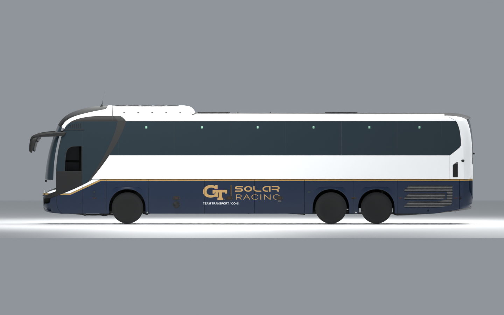
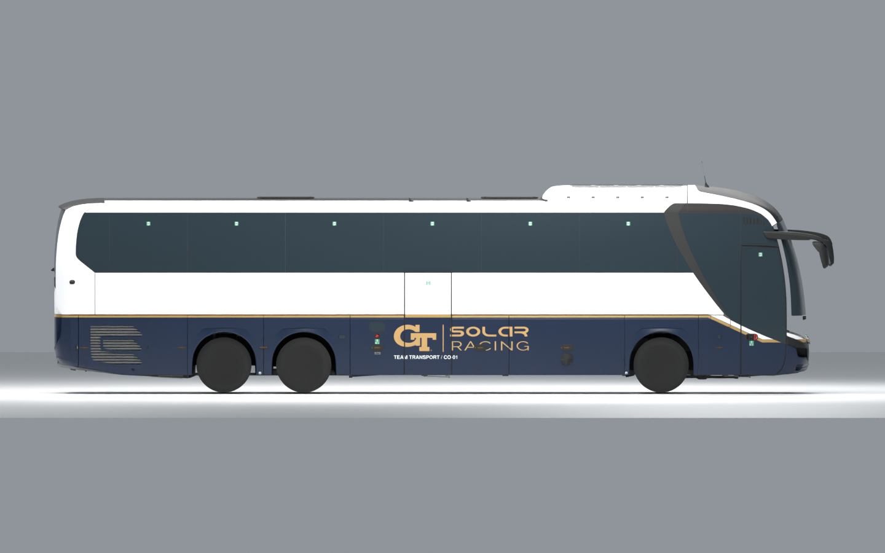
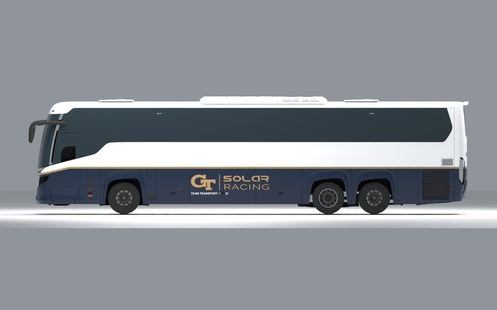
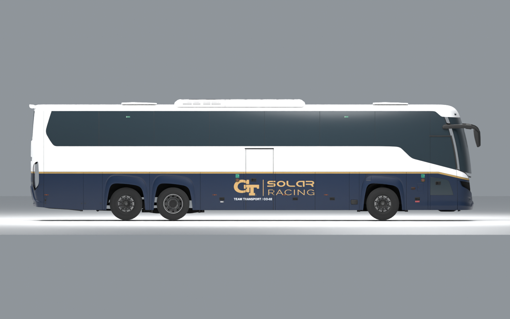

# MAN and Scania logo alignment — v0.5.2

The MAN Lion's Coach L 13.9 m and Scania Touring HD 13.7 m now share the same logo centerline and physical height on both sides. Each side has its own UV placement: using identical texture coordinates had left the MAN's right logo substantially lower.

The unchanged proportional GT Solar Racing mark occupies a 0.50 m tall image frame, centered 1.00 m above reference tire contact. Its top and bottom are 1.25 m and 0.75 m. The small fleet caption moves with the mark. Horizontal centers, stripes, panel colors and fleet numbers are retained.

| Coach | Left center before | Right center before | Both centers now |
| --- | --- | --- | --- |
| MAN 13.9 m | 0.911 m | 0.736 m | 1.000 m |
| Scania 13.7 m | 0.928 m | 0.916 m | 1.000 m |

These measurements use the standard reference wheels assembled by the local Blender workflow. Different game tire or suspension configurations may alter the absolute height above the road.

## Blender review









These are Blender studio renders using the packaged DDS textures, with approximate materials. Each vehicle is independently framed. Both side views and both front three-quarter views were reviewed, eight renders total. The saved scenes were reopened and checked for paint hashes and UV assignments. Exact ETS2 material behavior has not been tested in this patch.

## Install

Use [coach module v0.2.2](../mods/gtsr-coaches-v0.2.2.scs) and deactivate older coach copies. Existing coach paint IDs and menu choices remain. Truck v0.5.1 and trailer v0.1 are unchanged. The shorter MAN/Scania bodies and Volvo 9700 artwork are unchanged.

## Reproduce

```powershell
python source/align_coach_logos.py
python source/rebuild.py --texture man-lions-coach-139 --texture scania-touring-137
python source/validate_logo_alignment.py
```

The first command uses the distributed [calibrated placements](../source/logo-alignment-layouts.json) and current coach archive as its seed. To recalibrate against private local PIM/PIT geometry, add `--calibrate --models work/panel-refinement/converted`. The original game models are not distributed.

Follow the [Blender guide](BLENDER-VISUAL-CHECK.md) to render either coach. For the focused saved-scene check:

```powershell
blender --background --factory-startup --python-exit-code 1 --python source/check_blender_scenes.py -- work/logo-alignment --views left,right,front-left,front-right
```

The [381-check report](../source/logo-alignment-validation.json) records geometry measurements within 1 mm, proportional unchanged logo artwork, complete opaque BC3 mip chains, matching SVG rebuilds, preservation of 116 unrelated texture sets and unchanged truck/trailer archives. Only two DDS maps and the coach archive's version/description changed. The [18 saved-scene checks](../source/logo-alignment-blender-validation.json) passed.
