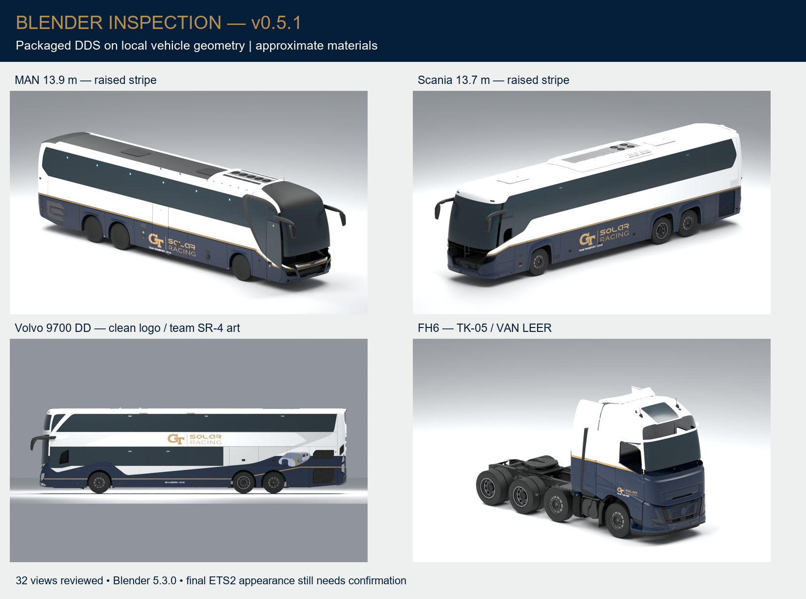

# Native screenshot feedback — v0.5.1

This records the preceding release. See the [v0.5.2 coach logo alignment](COACH-LOGO-ALIGNMENT.md) for the current coach-only patch.

This patch uses the 28 native v0.5.0 game captures and two stripe annotations. It also introduces a working [Blender inspection workflow](BLENDER-VISUAL-CHECK.md), used to review eight views of each of the four vehicles before packaging.



These are Blender renders using the packaged DDS artwork and private local vehicle geometry. Materials, glazing and accessories are approximations; these are not new ETS2 captures.

## Changes

| Vehicle | Result |
| --- | --- |
| MAN Lion's Coach L 13.9 m | Raised the navy/gold boundary to the marked luggage-panel line, at 1.44 m in the exported model frame; retained the front dip |
| Scania Touring HD 13.7 m | Raised the boundary to the marked panel line, at 1.54 m; added a gentle front transition to the existing front height |
| Volvo 9700 DD | Removed the rectangular navy logo plaque. The proportional original gold team mark now sits directly on white. Replaced the earlier sketch with the team's own SR-4 illustration, positioned beside the rear vents on the gold road |
| FH6 Aero Globetrotter XL | Restored **TK-05 / VAN LEER**. Painted lower-front bumper, fender and intake/inlay selections receive navy overrides; painted upper mirrors receive white overrides |

The illustration is the team-provided `GTSR SR4.png`, supplied through the user's linked shared drive. Its source pixels and proportions are preserved; it is positioned and mirrored as an image in the editable vehicle SVG. The other discovered renders, CAD files and branding-source files are not redistributed. This patch does not change the other 114 texture sets, the shorter coach maps or the trailer module.

The truck's white lower-front patches were caused by separate painted accessories falling back to atlas regions without explicit overrides. The mirrors had explicit navy assignments. These assignments are now coordinated for Van Leer. Raw plastic, chrome and glass remain material-dependent; the paint job does not replace the selected physical accessories.

## Install

Use [truck v0.5.1](../mods/gtsr-trucks-v0.5.1.scs) and [coach v0.2.1](https://github.com/harry-z-kang/ets2-solar-circuit-fleet/releases/download/v0.5.1/gtsr-coaches-v0.2.1.scs), with older truck/coach copies deactivated. Trailer v0.1 is unchanged. Select **Solar Circuit - Van Leer** on the Aero XL; existing coach menu names and paint IDs remain unchanged. Normal and stock 8×4 Aero XL suitability are retained.

The active ETS2 profile and user mod folder were not modified. The corrected build was inspected in Blender; its final appearance still needs checking in ETS2, especially painted tuning accessories and material gloss.

## Verification

The [static report](../source/feedback-fix-validation.json) checks all 118 texture sets, mounted references, exact archive changes, accessory assignments and the restored label. The [calibration record](../source/feedback-calibration.json) records 1,930 successful gold crossing samples, including painted doors. The [rebuild report](../source/feedback-fix-rebuild-validation.json) covers edited SVG exports, idempotent recipe regeneration and preservation of 114 unrelated texture sets.

The [Blender report](../source/blender-workflow-validation.json) records four reopened scenes, 32 rendered views, paint-file hashes and saved-scene/UV checks. Original scenes and meshes remain under ignored `work/`. The [native capture fingerprints](../source/feedback-fix-evidence.json) identify the screenshots and annotations without redistributing them.

## Rebuild

To preserve manual SVG edits, use `python source/rebuild.py`. To regenerate only this patch's four mapped SVGs from the included color bases and team illustration:

```sh
python source/build_feedback_fix.py
python source/validate_feedback_fix.py
```

The generator uses the current modules as seeds when v0.5.0 is absent. `--truck-seed` and `--coach-seed` select explicit prior archives. `--reuse-textures` reuses matching exports. It does not modify game files.

`source/calibrate_feedback_panels.py` optionally recalibrates color bases from the private local model exports. Those exports are not needed for the public artwork rebuild. After calibration or an SVG edit, rebuild the DDS and run the Blender workflow described in the linked guide.
