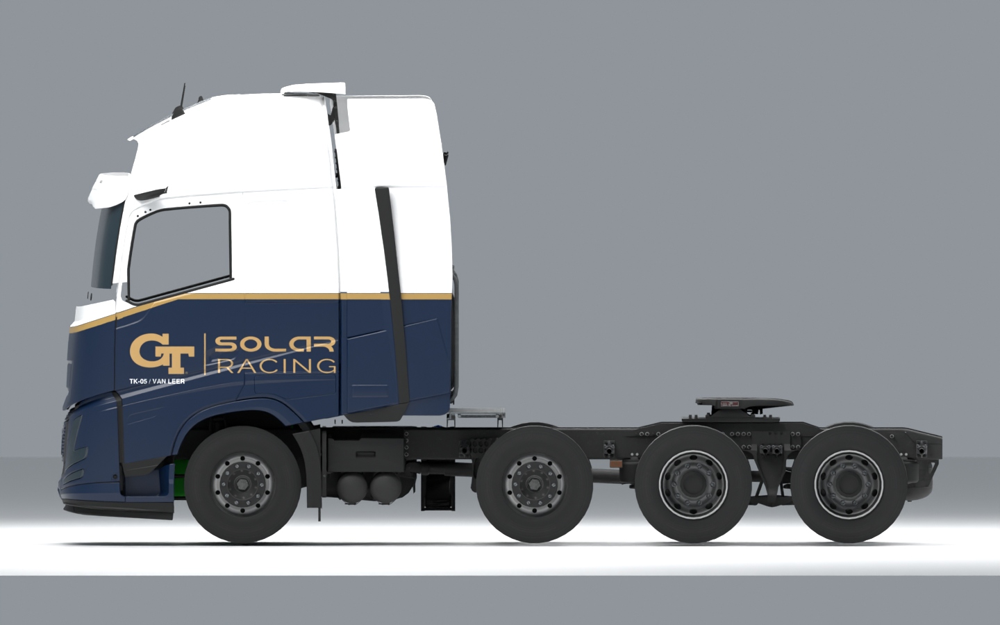
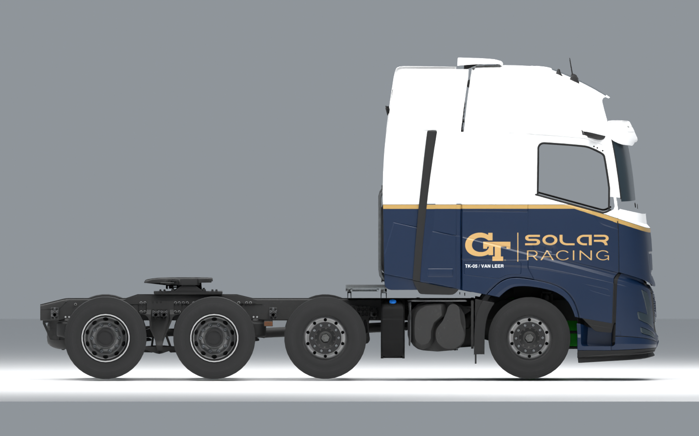
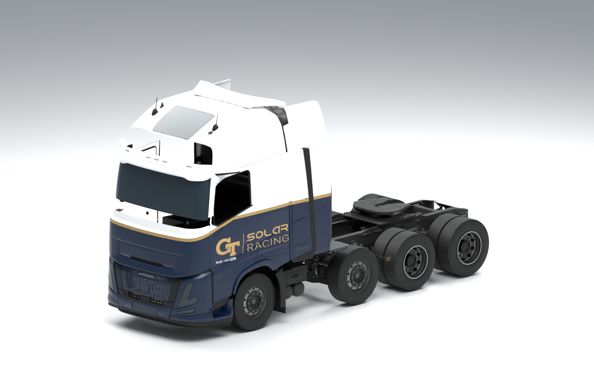
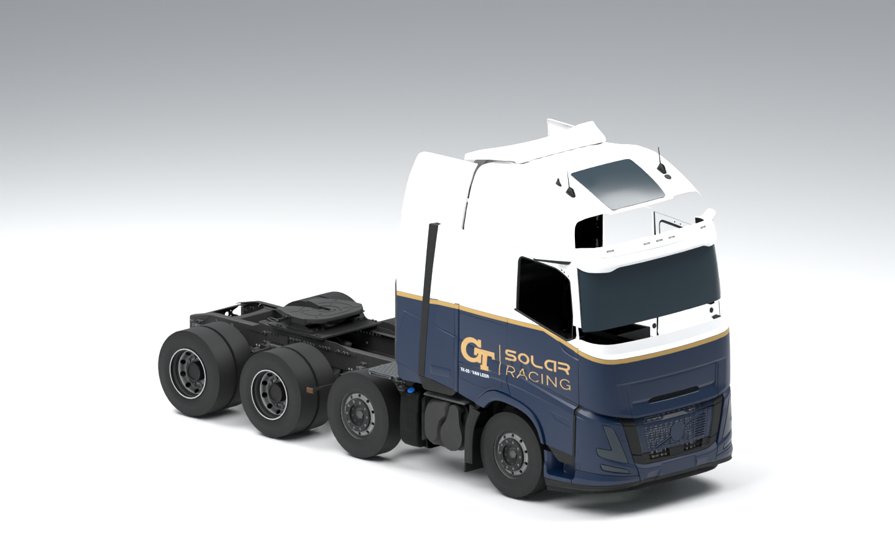
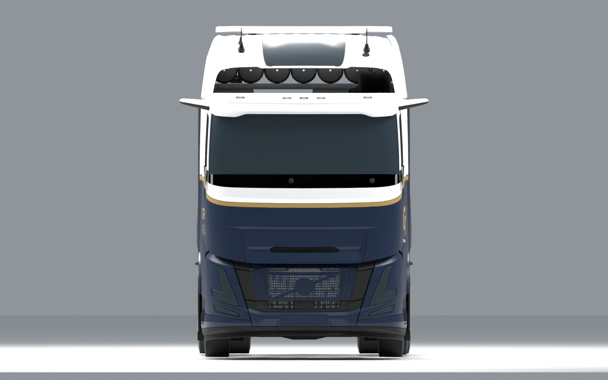

# FH6 front stripe and logo — v0.5.3

The FH6 Aero Globetrotter XL **Van Leer** gold stripe now slopes down toward the nose along the panel line and continues across the front panel. Both sides use the same physical profile, joining the front stripe at the corners.

The logo is **936 pixels wide**, keeping the reduced size with clearance from the front corners. It is 2.28 times the previous released width and height, spanning the door and adjacent panel. The logo and **TK-05 / VAN LEER** caption move down about **15 cm**, above the wheel arch. The caption retains its existing font size. The rear stripe height, white upper cab, navy painted headlight surrounds and wheel arches, white painted mirrors and white painted sunshades are preserved.

## Blender review









Both side views, both front three-quarter views and a straight front view were reviewed using the packaged DDS in Blender. All opaque logo pixels remain on the painted cab UVs. Original game meshes and private scenes are not distributed. Blender materials and reference accessories are approximate; final ETS2 appearance has not been tested in this patch.



## Install

Replace the previous truck module with [truck v0.5.3](../mods/gtsr-trucks-v0.5.3.scs), deactivate the older truck copy, and retain **Solar Circuit - Van Leer** on the FH6 Aero XL. Coach v0.5.3 and trailer v0.5.3 are unchanged.

The FH6 artwork change affects only its main cab DDS. All three module filenames and Mod Manager versions now use v0.5.3. Apart from version/description metadata, other archive members, 117 unrelated texture sets, accessory assignments, coach/trailer gameplay payloads, menu names and paint IDs are preserved. See the [module version checks](../source/module-version-validation.json). No active game profile or user mod folder was modified.

## Rebuild

```powershell
python source/enlarge_fh6_logo.py
python source/rebuild.py --texture trk_volvo_fh_2024_cabin_b_aero
python source/validate_fh6_logo.py
```

The [layout](../source/fh6-logo-layout.json) records both placements and the shared stripe profile. The generator uses the current truck archive as its seed, or an explicit `--truck-seed` path. Add `--calibrate --models work/panel-refinement/converted` to regenerate the authored color base from private local geometry. The [calibration record](../source/fh6-stripe-calibration.json) records its hash. Follow the [Blender guide](BLENDER-VISUAL-CHECK.md) to inspect the current version.

The [379-check report](../source/fh6-logo-validation.json) includes 342 gold-stripe probes across both sides and the front, original mark proportions, painted cab UV coverage, complete opaque BC3 mipmaps, matching SVG rebuilds, unchanged pixels outside the stripe and logo/caption regions, and prior-release preservation checks. The [15 reopened-scene checks](../source/fh6-logo-blender-validation.json) passed. Five Blender views reviewed.
