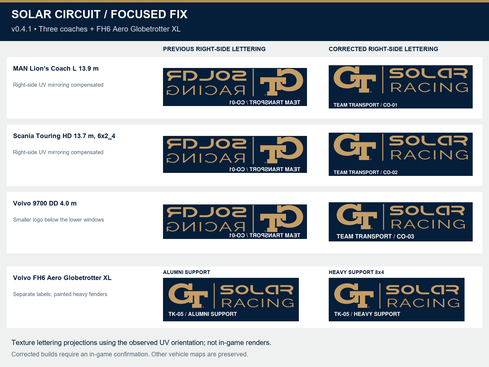

# Focused livery correction — fleet v0.4.1

This patch uses the 25 new screenshots to address only the requested vehicles:

| Vehicle | Correction |
| --- | --- |
| MAN Lion's Coach L 13.9 m | Compensated right-side logo/text for mirrored UV mapping; reduced the side wordmark and fleet line |
| Scania Touring HD 13.7 m, 6x2_4 | Same right-side correction; smaller lettering; distinct CO-02 fleet ID |
| Volvo 9700 DD 4.0 m | Same right-side correction; smaller, lower logo placed in the narrow painted bay beneath the lower windows; CO-03 fleet ID |
| Volvo FH6 Aero Globetrotter XL — Alumni Support | Smaller logos positioned clear of the marked handle and door-seam regions; lower navy coverage extended over the mapped front-fender area |
| Volvo FH6 Aero Globetrotter XL — Heavy Support 8×4 | Same cab placement correction; dedicated HEAVY SUPPORT map; explicit navy assignments for painted rear fenders and painted/part-chrome fender tops |



The comparison is made from paint textures projected using the side orientation established by the supplied screenshots. It is **not an in-game capture of the corrected build**. Detail crops are scaled to show reading direction, not relative physical logo sizes.

## Install

1. Remove/deactivate older Solar Circuit **truck and coach** modules in your active ETS2 mod folder.
2. Install [gtsr-trucks-v0.4.1.scs](../mods/gtsr-trucks-v0.4.1.scs) and [gtsr-coaches-v0.1.1.scs](../mods/gtsr-coaches-v0.1.1.scs). Keep one version of each module enabled. The coach module still requires SCS Coaches DLC.
3. Existing paint-job IDs and prices are retained, so the selected paint jobs can continue using their existing definitions. Re-select the matching paint job in the configurator if necessary.
4. Inspect both coach sides and the Volvo DD lower window edge; inspect both FH6 cab sides and the heavy rear fenders with your chosen painted accessories.

The trailer module remains v0.1. Shorter MAN 12.1 m and Scania 12.9 m coach maps are unchanged; their right sides remain outside this focused correction. Other truck cabs and paint definitions are preserved. The standard Aero XL Alumni map is shared by its compatible normal and 8×4 cabin units, so both receive that cab-art correction. The heavy-specific changes apply only to `l2h3_8x4_a` with the stock `8x4` chassis.

## What the screenshots established

All three coaches' right-side marks were mirrored; the previous map corrected only the vertical direction of the upper UV shell. The patch mirrors the lettering locally while keeping the existing background, solar decoration, front, rear and roof regions intact. It does not reverse the entire side design.

On the double-decker, the former 1450-pixel wordmark crossed the lower-window opening. The new proportional 650-pixel wordmark sits lower in a clear bay between the axles. On the FH6, the previous large cab marks and fleet line reached the handle/seam area. Its heavy accessory definition also lacked rear-fender overrides, allowing those parts to sample fragments of the main cab artwork. Three official Volvo tuning accessory identifiers were verified before adding their navy assignments.

Screenshots are recorded by filename/hash in [focused-fix-evidence.json](../source/focused-fix-evidence.json). Original user images, game files, templates and wireframe overlays are not redistributed.

## Checks and limits

**1477/1477 focused checks passed** ([report](../source/focused-fix-validation.json)). Checks cover all 115 texture exports, complete BC3 mip chains, opaque body alpha, references in all three modules, 78 truck and five coach paint definitions, exact heavy restrictions, and official fender IDs. Pixel comparisons of the rendered opposite-side lettering against the left-side reference passed for all three coaches. Five template overlays and all 25 supplied screenshots were reviewed.

**1113/1113 workflow checks passed** ([report](../source/focused-fix-rebuild-validation.json)). Selected coach, conditional truck and dedicated heavy texture edits were rebuilt through the normal utility. Recipe regeneration reproduced every member of both corrected modules. Every unrelated SVG/PNG/DDS export and the complete trailer module matched the preceding release.

The preservation comparison limits changes to three existing coach DDS members plus package metadata, and the selected FH6 cabin DDS, heavy mask/accessory definitions, two new heavy texture members and package metadata. Existing coach paint IDs, shorter coach maps, all other truck entries and all previous heavy restrictions are retained.

**The corrected build still needs an in-game confirmation** of appearance, seams, gloss and painted accessory combinations. No ETS2 session was launched and no active profile was modified by this build. These checks substantiate the targeted map/definition corrections; they do not claim finished runtime validation.

## Edit or regenerate

Edit the five targeted SVGs listed in [focused-fix-layouts.json](../source/focused-fix-layouts.json), then use the regular rebuild utility:

```sh
python source/rebuild.py --texture volvo-9700-dd --texture trk_volvo_fh_2024_cabin_b_aero --texture h8_volvo_fh_2024_aero_xl
```

The Alumni and Heavy Support FH6 sources are separate so that their role labels remain distinct. To regenerate this focused recipe from the included maps and current modules:

```sh
python source/build_focused_fix.py --truck-seed mods/gtsr-trucks-v0.4.1.scs --coach-seed mods/gtsr-coaches-v0.1.1.scs
```

This overwrites the targeted lettering/layout edits. Use `rebuild.py` to retain manual edits. Optional `--templates /path/to/templates.zip --qa-dir /private/qa` checks the pinned Paint Job Packer v2.1.3 archive and creates private overlays. Template member hashes are in [focused-fix-template-hashes.json](../source/focused-fix-template-hashes.json). Run this focused recipe last when reconstructing earlier expansion stages.
