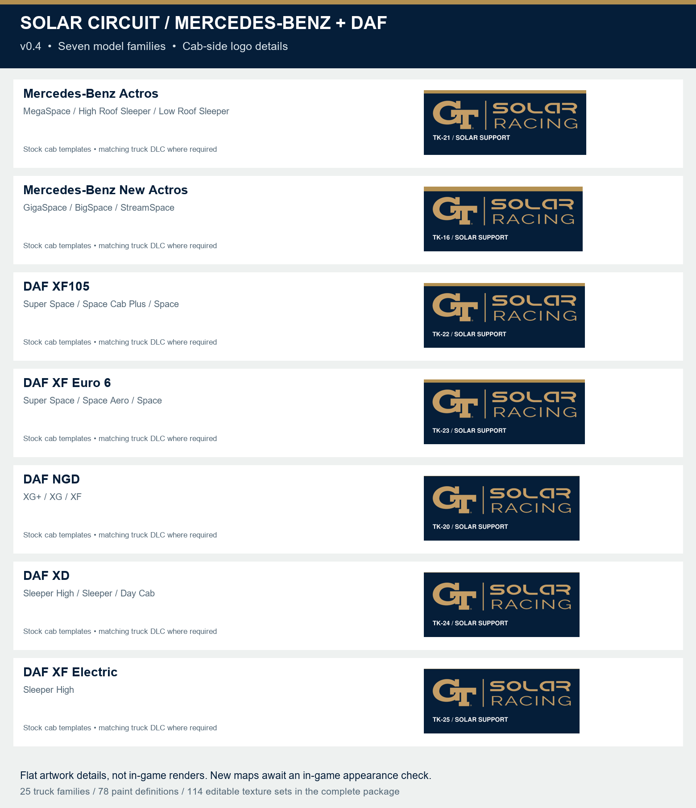

# Mercedes-Benz and DAF liveries — version 0.4 recipe

**Current fleet release: 0.4.1.** The [focused coach/FH6 patch](FOCUSED-FIX.md) preserves this Mercedes/DAF coverage. Counts and validation below describe the 0.4 stage; the complete package now has 115 texture sets. Use the current module for installation; an original 0.4 seed remains available from its GitHub release for recipe reconstruction.

The truck module now covers **all seven standard SCS Mercedes-Benz and DAF families present in the inspected ETS2 1.62.3.3 installation**. This addition supplies 19 standard-cab paint definitions, refreshes four existing Heavy Support maps, and preserves the previous truck coverage. The whole truck module contains **25 families and 78 paint definitions**.



These are crops of our paint artwork, not game renders. The new maps have been checked against exact UV templates; they still require an in-game appearance test.

## Exact coverage

| Family | Cabins | Package section |
| --- | --- | --- |
| Mercedes-Benz Actros | MegaSpace; High Roof Sleeper; Low Roof Sleeper | `base` |
| Mercedes-Benz New Actros | GigaSpace; BigSpace; StreamSpace; existing GigaSpace 8×4 | `base` |
| DAF XF105 | Super Space Cab; Space Cab Plus; Space Cab | `base` |
| DAF XF Euro 6 | Super Space Cab; Space Cab with spoiler; Space Cab | `base` |
| DAF NGD | XG+; XG; XF; all three existing 8×4 options | `dlc_daf_2021` |
| DAF XD | Sleeper High; Sleeper; Day | `dlc_daf_xd` |
| DAF XF Electric | Sleeper High | `dlc_daf_xf_electric` |

Standard-cab options use the vehicle's compatible stock chassis. Existing Heavy Support options retain their exact cabin/chassis restrictions. This does not add vehicle models, third-party chassis, or trucks absent from the inspected game. Conditional sections mount with their matching truck DLC; unrelated sections remain available without those DLCs.

## Install and upgrade

1. Deactivate/remove older Solar Circuit truck modules from your active ETS2 mod folder.
2. Copy [current truck module](../mods/gtsr-trucks-v0.5.4.scs) into that folder and activate it in Mod Manager. Enable only one truck-module version.
3. Choose **Solar Circuit - Alumni Support** for the matching cabin, or **Solar Circuit - Heavy Support 8x4** for a listed heavy configuration. Price: EUR 1,000; unlock level: 0.
4. Check both sides, front, rear, roof and painted parts before applying it across the fleet. The [screenshot checklist](SCREENSHOT-CHECKLIST.md) describes useful views.

Trailer and coach modules remain at version 0.1. The supplied screenshots document issues in earlier maps, including mirrored coach text and trim crossing logos. This Mercedes/DAF expansion does not fix those other vehicle maps. No active game profile was modified by this build.

## Artwork and accessories

Smaller proportional gold logos sit within planned navy cab panels, with white upper panels, gold rails, solar-cell roof details and circuit traces. Logo positions avoid the marked door-handle regions in the templates. Runtime trim and material boundaries still need checking.

There are **20 unique cab atlases** in this recipe, including the refreshed Actros heavy cab; three DAF heavy aliases reuse their corresponding standard maps. The addition creates **29 new texture sets**, refreshes **four existing sets**, and brings the whole package to **114 SVG/PNG/DDS texture sets**. These counts include trailers, coaches and fallback colors.

Ten dedicated DAF accessory maps cover available visors, mirrors and skirts. Mirror maps are plain white; visors are navy; skirts carry rails and traces without lettering. Other verified paintable accessories use solid navy where listed. **93 stock/tuning accessory identifiers** were checked against the installed base, truck DLC and official Actros/DAF tuning definitions. Main-cabin UV parts retain their cabin artwork. Unlisted third-party accessories require their own templates.

Exact cabin units, texture paths, source member hashes and accessory assignments are recorded in [mercedes-daf-support.json](../source/mercedes-daf-support.json). Placement rectangles are editable in [mercedes-daf-layouts.json](../source/mercedes-daf-layouts.json).

## Edit and rebuild

Edit the relevant `md_*.svg` in `textures/`, keeping its original canvas size. Actros heavy uses `h8_mercedes_actros2014_cab`; DAF heavy uses `h8_daf_2021_xf`, `h8_daf_2021_xg` or `h8_daf_2021_xg_plus`. Standard and heavy DAF copies are independent exports after generation; update both if you want matching manual edits.

```sh
python -m pip install -r source/requirements.txt
python source/rebuild.py --texture md_mercedes_actros_megaspace --texture md_daf_xd_day
```

Updated modules are written under `rebuilt/mods/`. Install originals or rebuilt modules, keeping only one copy of each module.

To regenerate the recipe from Carsmaniac's original [complete PNG/PSD template pack](https://truckymods.io/euro-truck-simulator-2/tools/ets2-truck-and-trailer-templates-947834):

```sh
python source/build_mercedes_daf.py --templates "/path/to/ETS2 templates, game ver. 1.59.zip" --base-mod mods/gtsr-trucks-v0.4.scs
```

The generator checks the archive and member SHA-256 values. Expected archive SHA-256: `a0be74b062363f66ed6577fb6a87ab3d5072b2516cfc56697aa6f1bb530ffde5`. It replaces this addition's generated maps and definitions while retaining earlier coverage. Recipe generation overwrites manual edits; use `rebuild.py` to retain them. The older 0.2 and 0.3 generators are historical stages; run this 0.4 recipe last when reconstructing the full sequence.

Original templates, wireframes, private QA overlays and extracted game files are not included. Vehicle metadata and definition patterns are credited in [ATTRIBUTION.txt](../credits/ATTRIBUTION.txt).

## Validation and limits

**1596/1596 static checks passed** ([report](../source/mercedes-daf-validation.json)). Checks cover all 114 texture sets, DDS headers and complete mip payloads, opaque body alpha, mounted texture references, all 78 unique paint definitions, exact current cab inventories, 93 accessory IDs, preservation of all 20 heavy restrictions and unrelated earlier gameplay entries. All 30 new/refreshed template overlays were reviewed, along with the 27 user-supplied feedback screenshots.

The [rebuild report](../source/mercedes-daf-rebuild-validation.json) checks selected base, conditional-DLC and heavy-alias editing paths and confirms recipe regeneration reproduces every module member. Earlier version reports remain historical.

**The new Mercedes/DAF maps have not been tested in an ETS2 session.** Final side reading direction, seams, gloss, roof placement, tuning combinations and compatibility with other mods remain subject to in-game checks. User screenshots show earlier modules loading, with visible alignment and mirroring issues still recorded in the [checklist](SCREENSHOT-CHECKLIST.md).
