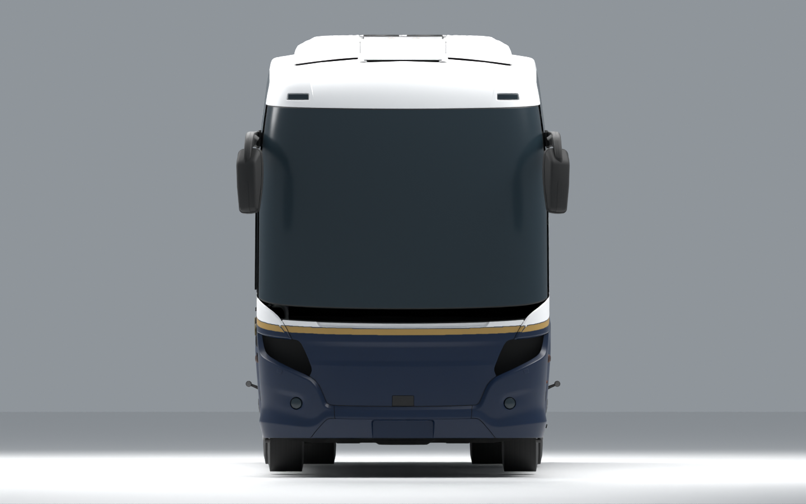
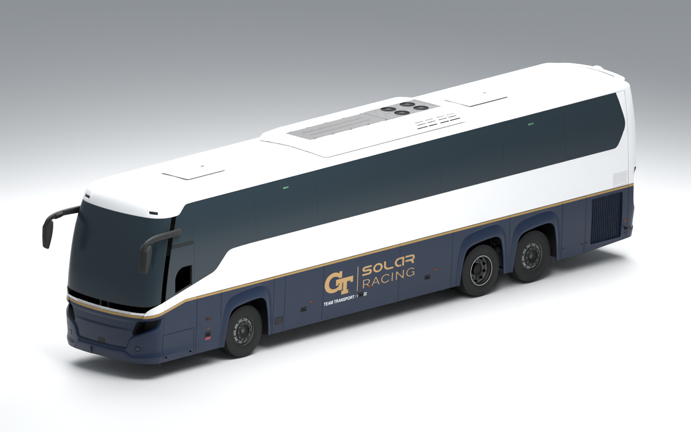
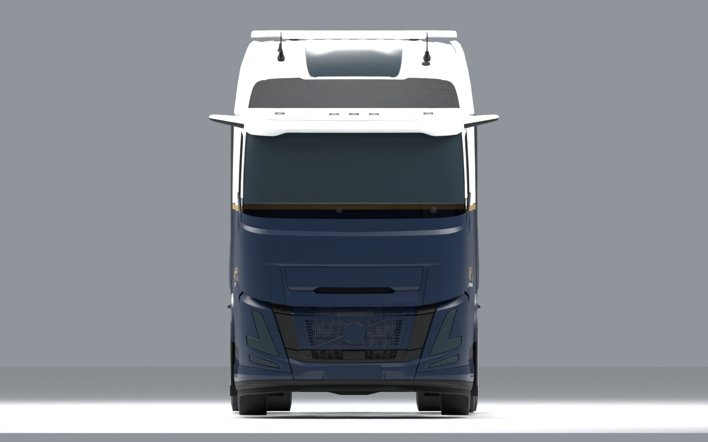
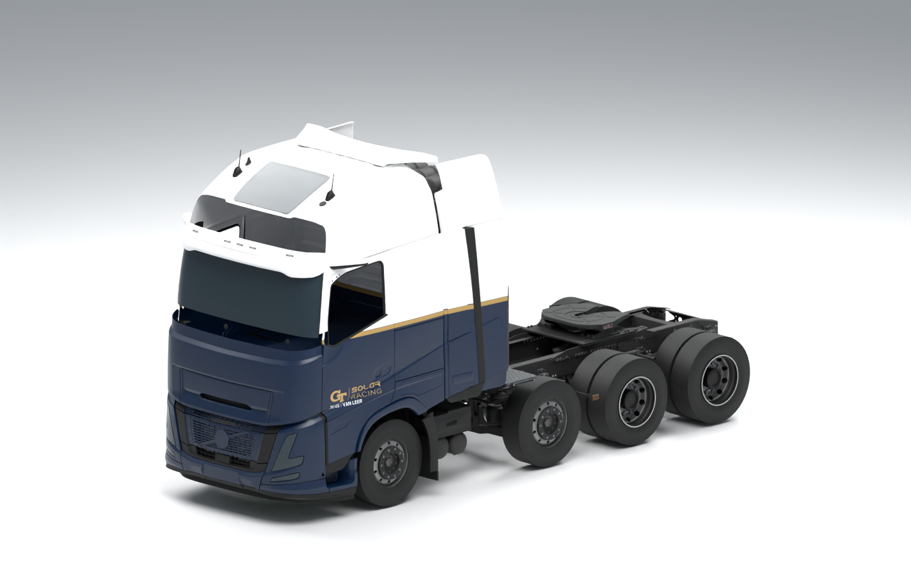

# Scania and FH6 painted parts — v0.5.3

The Scania Touring HD 13.7 m front intake now continues the navy lower panel and gold stripe across the center. On the FH6 Aero Globetrotter XL **Van Leer** livery, painted cab wheel arches and the Exclusive Aero headlight surrounds use navy. All five paintable sunshade options use white.

The Scania intake was missing from the earlier color projection. It uses a reserved island of the existing body atlas, so this patch fills that island using the same physical stripe profile as the surrounding body. The front panel's paint UV alias is `_TEXCOORD1`. The painted wheel arches and Exclusive headlights needed their own FH6 accessory assignments; the painted sunshades previously had navy assignments.

## Install and select the painted parts

Install [truck v0.5.3](../mods/gtsr-trucks-v0.5.3.scs) and [coach v0.2.3](../mods/gtsr-coaches-v0.2.3.scs), deactivating older truck and coach modules. Trailer v0.1 is unchanged. Paint-job IDs, names and suitability are retained.

- Scania: select the **Standard Painted** front intake, replacing Standard Plastic. The existing Solar Circuit paint job supplies the new front band.
- FH6 Aero XL: retain **Solar Circuit - Van Leer**, select painted cab fenders, and use Stock Aero or Exclusive Aero headlights. Painted sunshade options now inherit white. **TK-05 / VAN LEER** and the white painted mirrors remain.

No vehicle defaults, prices, tuning choices, active profiles or user mod folders were changed. The MAN, Volvo 9700 and shorter coach maps remain unchanged. The Scania's aligned side logo pixels are also unchanged.

## Blender review









Ten Blender views were reviewed against the three native v0.5.2 screenshots: front, both front three-quarter views, left and right for each vehicle. The local configuration now includes the Scania painted intake, FH6 painted cab fenders, Exclusive Aero headlights and Quatro painted sunshade. Original meshes, game textures and scenes remain private. Materials and reference wheels are approximate; this patch still needs a native ETS2 appearance check.

## Rebuild and verify

```powershell
python source/build_accessory_fix.py
python source/rebuild.py --texture scania-touring-137
python source/validate_accessory_fix.py
```

The generator uses the authored color base and current archives. It retains the [0.5.2 logo calibration](COACH-LOGO-ALIGNMENT.md). To project the front band again from private local geometry, add `--calibrate --models work/panel-refinement/converted` to the first command. Optional `--truck-seed` and `--coach-seed` select the previous archives explicitly.

The [1,479 checks](../source/accessory-fix-validation.json) passed, including 1,088 front-surface color samples, complete BC3 mipmaps, matching SVG rebuilds, exact preservation of 117 unrelated texture sets and unchanged Scania logo pixels. The coach archive changes only the Scania DDS and metadata. The truck archive changes only Van Leer's accessory assignments and metadata. The [25 reopened-scene checks](../source/accessory-fix-blender-validation.json) passed. See the [Blender workflow](BLENDER-VISUAL-CHECK.md) for rendering instructions.
