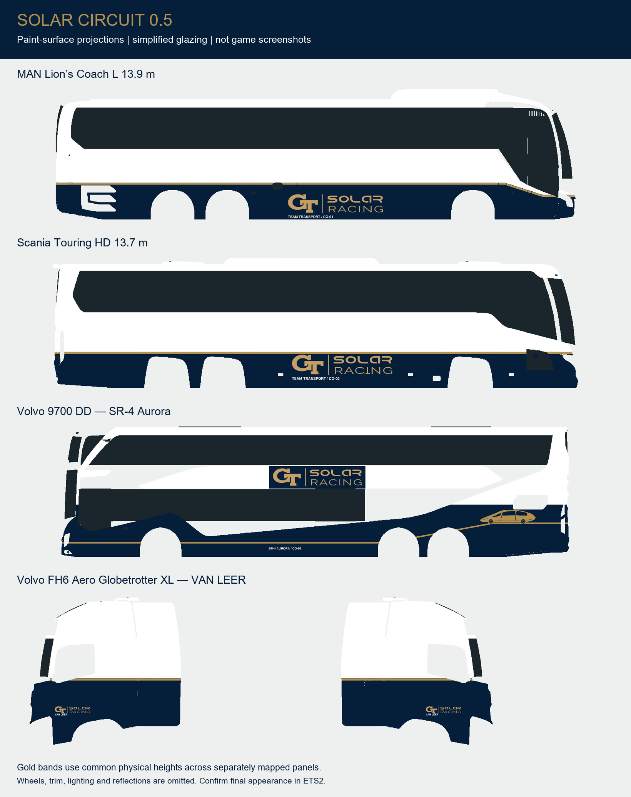

# Panel refinement — v0.5.0

This update responds to the v0.4.0/v0.4.1 comparison screenshots for MAN Lion's Coach L 13.9 m, Scania Touring HD 13.7 m, Volvo 9700 DD and Volvo FH6 Aero Globetrotter XL. It replaces rectangular atlas guesses with paint masks calibrated to the actual painted surfaces, including separate door and end-panel islands.



The preview shows paint-surface projections with simplified glazing. It is not an ETS2 capture; trim, wheels, lights, interior details, reflections and shadows are omitted.

## Coaches

The MAN and Scania have a common navy boundary and gold band across their painted body, door, front bumper, rear bumper and rear panel islands. The MAN band dips around the front to pass below the grille. Unpaintable glass and trim naturally interrupt paint. Previously corrected right-side wordmark orientation is retained.

The Volvo 9700 DD gets a special **SR-4 Aurora** treatment. The unchanged gold team mark sits on a navy plaque in the white band between the window rows, following the annotated suggestion. An original editable silhouette occupies the rear side bay between the vents, facing forward on both sides. A gold road runs through the narrow lower strip and rises toward the car. The small lower caption reads `SR-4 AURORA / CO-03`.

The silhouette is a stylized interpretation of the team's [SR-4 Aurora](https://solarracing.gatech.edu/cars/), using the [team's side reference](https://solarracing.gatech.edu/files/2025/09/sr4-2-1536x864.jpg). Reference photos and sponsor marks are not bundled.

The shorter MAN 12.1 m and Scania 12.9 m maps are unchanged.

## FH6 Van Leer

For the **Aero Globetrotter XL only**, `Solar Circuit - Van Leer` replaces the Alumni Support menu name. The cab reads **VAN LEER**, without the old TK-05 / Alumni Support line. Its existing paint identifier is retained, with both regular and stock 8×4 Aero XL cabin suitability.

The duplicate `Solar Circuit - Heavy Support 8x4` entry for this cabin is removed. Heavy Support was a paint selection with explicit cabin/chassis suitability and accessory overrides; it did not change hauling performance. Van Leer retains 8×4 availability and navy painted rear-fender assignments. Other trucks' Heavy Support selections are unchanged.

The cab, standard/Aero side deflectors, 8×4 upper deflector and painted 8×4 equipment housing receive coordinated maps. These separate accessory maps carry no stray cab lettering. Cab lettering sits below the handle area. Other cab variants and existing sideskirt maps are unchanged.

## Install and upgrade

1. If the Aero XL currently uses the old Heavy Support selection, switch it to Alumni Support before replacing the old truck module, or select Van Leer after upgrading. The removed Heavy identifier cannot retain a saved paint selection.
2. Deactivate/remove older truck and coach module copies. Install only [truck v0.5](../mods/gtsr-trucks-v0.5.scs) and [coach v0.2](../mods/gtsr-coaches-v0.2.scs). The [trailer v0.1](../mods/gtsr-trailers-v0.1.scs) module is unchanged.
3. Select **Solar Circuit - Van Leer** on the Aero XL. The three coach selections retain their existing **Solar Circuit - Alumni Support** names. Price remains EUR 1,000, unlock level 0.
4. Inspect doors, both sides, front/rear corners and your painted accessories in daylight. SCS Coaches DLC and the appropriate truck content are required.

No active game profile or user mod folder was modified. The new build has not been loaded into ETS2; seams, gloss and accessory combinations still need an in-game appearance check.

## Calibration and checks

Local model exports were used privately to project common physical-height bands through the stream aliased as `TEXCOORD1`. Stream numbers differ between main bodies and some accessories. Door/end-panel islands and attachment transforms were included. Three pixels of navy edge padding and one pixel of gold padding reduce texture-edge seams.

The distributed [calibration record](../source/panel-calibration.json) contains mask hashes, part identifiers and counts from 2,490 gold crossing probes. All probes matched the intended gold color, including crossings on all three coaches' painted doors. The distributed `artwork/panel-bases` files contain only authored white/navy/gold pixels. Original model geometry, wireframes and reference screenshots remain private.

The [validation report](../source/panel-refinement-validation.json) checks all 118 texture sets, BC3 mip chains, mounted texture references, opposite-side wordmarks, definitions, masks and strict archive preservation. The [workflow report](../source/panel-refinement-rebuild-validation.json) checks selected SVG rebuild paths, recipe reproduction and unchanged unrelated exports. The [package report](../source/panel-refinement-package-validation.json) covers install inventory, file sizes, links and archive integrity.

The new evidence comprises 37 v0.4.1 captures and one annotated suggestion, compared with the 25 v0.4.0 captures. See [evidence fingerprints](../source/panel-refinement-evidence.json); images are not redistributed.

## Editing

Edit a mapped SVG and run `python source/rebuild.py` to preserve manual artwork edits. For a selected rebuild:

```sh
python source/rebuild.py --texture volvo-9700-dd --texture trk_volvo_fh_2024_cabin_b_aero --texture vl_fh6_aero_side
```

To regenerate the eight selected maps from the included color bases and editable [layout parameters](../source/panel-refinement-layouts.json):

```sh
python source/build_panel_refinement.py
python source/validate_panel_refinement.py
```

The generator uses the current modules as seeds when the previous modules are absent. It overwrites the eight mapped SVGs, so save manual edits first. `--reuse-textures` reuses matching exports. Original game data and the converter are not required for this public rebuild.
