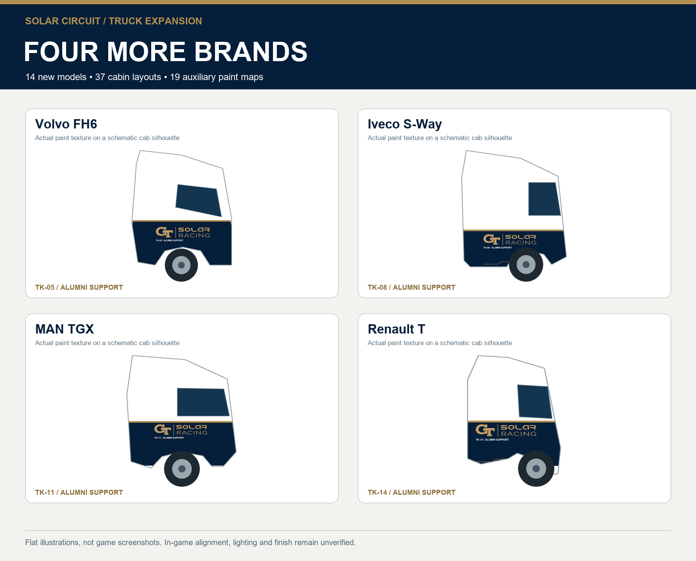

# Solar Circuit earlier truck coverage — version 0.2 recipe

**Current release: version 0.4.1.** See the [focused coach/FH6 correction](FOCUSED-FIX.md). The [Mercedes/DAF expansion](MERCEDES-DAF-LIVERIES.md) extends standard cabin coverage. The [8×4 expansion guide](8X4-LIVERIES.md) adds all standard SCS 8×4 chassis while preserving the files described below.

The version 0.2 truck module includes **15 SCS truck models and 39 cabin layouts**: the original two Scania S 2016 cabins plus 37 new cabins across Volvo, Iveco, MAN and Renault. The expansion adds 56 editable SVG/PNG/DDS textures: 37 main cabin maps and 19 auxiliary maps. The full fleet package now contains 75 textures.



The preview shows actual paint regions on schematic cab illustrations. It is not an in-game screenshot. Every new cabin and auxiliary map was reviewed against its wireframe template; no ETS2 game session has been launched.

## Install or upgrade

1. Remove or deactivate older truck-module versions from your ETS2 mod folder.
2. Copy [current truck module](../mods/gtsr-trucks-v0.5.1.scs) into that folder and activate it in Mod Manager. Keep only one version of the truck module enabled.
3. Select **Solar Circuit - Alumni Support** in the matching truck's paint shop. Price: EUR 1,000; unlock level: 0.
4. Check both sides, front, rear, roof, seams and painted accessories on each cabin/chassis combination before applying it across the fleet.

The trailer and coach modules remain version 0.1 and can stay enabled. No files were installed into your active ETS2 profile by this build.

## New truck coverage

| Model | Cabin layouts | Cabin maps | Auxiliary maps | Conditional section |
| --- | --- | --- | --- | --- |
| Volvo FH3 | Globetrotter XL; Globetrotter; Sleeper | 3 | 0 | `base` |
| Volvo FH4 | Globetrotter XL; Globetrotter; Sleeper | 3 | 2 | `base` |
| Volvo FH5 | Globetrotter XL; Globetrotter; Sleeper | 3 | 2 | `dlc_volvo_fh_2021` |
| Volvo FH6 | Globetrotter XXL; Aero Globetrotter XXL; Globetrotter XL; Aero Globetrotter XL; Globetrotter; Aero Globetrotter; Sleeper; Aero Sleeper | 8 | 3 | `dlc_volvo_fh_2024` |
| Iveco Stralis | Active Space Super; Active Super; Active Space | 3 | 0 | `base` |
| Iveco Stralis Hi-Way | Hi-Way | 1 | 0 | `base` |
| Iveco S-Way | Active Space | 1 | 1 | `dlc_iveco_sway` |
| MAN TGX Euro 5 | XXL; XLX; XL | 3 | 0 | `base` |
| MAN TGX Euro 6 | XXL; XLX; XL | 3 | 5 | `base` |
| MAN TGX | GX; GM; GN | 3 | 2 | `dlc_man_tgx_2020` |
| Renault Magnum | Excellence | 1 | 0 | `base` |
| Renault Premium | High Roof; Normal Roof | 2 | 0 | `base` |
| Renault T | High Sleeper; Sleeper | 2 | 3 | `base` |
| Renault E-Tech T | Sleeper | 1 | 1 | `dlc_renault_etech_t` |

The original Scania S High Roof and Normal Roof definitions and texture files are preserved byte-for-byte under the package's `base` section. Version 0.3 adds separate Heavy Support options for all stock 8×4 configurations; see the [exact coverage table](8X4-LIVERIES.md). Third-party truck mods are not mapped.

## Optional truck content

The module uses SCS's conditional package layout: `base/` always loads, while a `dlc_*` section loads only when that exact truck DLC is present. This covers Volvo FH5, Volvo FH6, Iveco S-Way, modern MAN TGX and Renault E-Tech T. It does not require all five truck DLCs to use the older trucks. Virtual paint paths omit these mount-directory prefixes. See [SCS mod packaging documentation](https://modding.scssoft.com/wiki/Documentation/Engine/Mod_manager).

Available auxiliary wireframes receive separate navy/gold skirt or white/navy deflector maps. Paintable accessories without a separate wireframe in the archive receive solid navy (or white for unmapped deflectors). The Renault T tuning-pack short-skirt group uses its matching standard short-skirt atlas. Manufacturer emblems and non-paintable trim are still controlled by the vehicle models.

## Editing and rebuilding

The `trk_*.svg` files in `textures/` are the editable livery sources. Edit those directly, then run `python source/rebuild.py` to rebuild the PNG/DDS exports and module copies under `rebuilt/`. The rebuilding utility supports the conditional package layout.

To regenerate this expansion from its layout recipe instead, first obtain the [author's original template archive](https://github.com/Carsmaniac/paintjob-packer/releases/download/v2.1.3/templates.zip), install `source/requirements.txt`, and run:

```sh
python source/build_truck_expansion.py --templates /path/to/templates.zip --base-mod /path/to/gtsr-trucks-v0.2.scs
```

This historical generator produces version 0.2 and needs a version 0.1/0.2 seed from repository history. Run `build_8x4.py` afterward to produce version 0.3, then `build_mercedes_daf.py` to produce version 0.4. For normal edits use `rebuild.py` on the current package.

The layout recipe is in `source/truck-livery-layouts.json`; the vehicle/cabin/accessory metadata is in `source/expanded-truck-vehicles.json`. Recipe regeneration replaces the expansion's SVG maps, so use `rebuild.py` when preserving hand edits. Original template wireframes and game data are not redistributed.

## Validation

**777/777 static checks passed.** The [detailed report](../source/expansion-validation.json) includes DDS dimensions, BC3/DXT5 mip chains and alpha, archive integrity, paint-job counts, mounted TOBJ/DDS paths, conditional mounting, cabin IDs read from the installed ETS2 1.62.3.3 base and truck DLC definitions, and preservation of the existing Scania files.

The upstream metadata contains `l3h34_8x4` for the standard FH6 Globetrotter XXL 8x4. This build corrects it to the installed game's actual unit, `l3h3_8x4`. The source template catalog remains a record of the author's metadata; this build uses the corrected runtime metadata.

All 37 main cabin and 19 auxiliary overlays were visually reviewed. Runtime loading, side reading direction, exact seams, gloss, optional tuning-part combinations, Convoy and interactions with other mods remain unverified. These are installable test liveries, not a claim of complete in-game QA.
